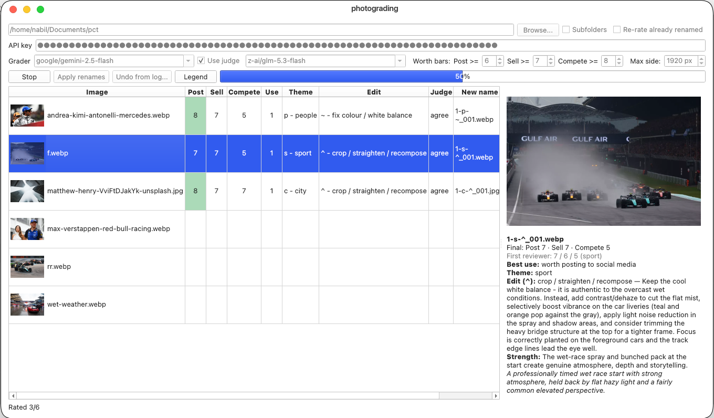

# PHOTOGRADER

Hello everyone good morning/afternoon/evening, so what is photo grader? well let me tell a story first, a few years ago when im still a child, i love photography, but im so lazy to pick up the best photo for each and each, well its 5 years ago and now we have AI, NICE what if ai rate the photos for its best use?? well thats why im building this

## App Demo
<<<<<<< HEAD

=======

>>>>>>> 0d0c56c (V6)
[demo video](./demo.webm)

## Installation

im in Arch Linux currently, and im lazy to run my VM just for compiling exe/deb so i compile it as appimage which is realy nice, how to run?

- just download the app
- set ur key
- select the folder with the photo you wanna short
- press grade it
<<<<<<< HEAD
=======
- after some waiting the results will come out
>>>>>>> 0d0c56c (V6)
- it would also reccomend to rename, just press yes and it will be renamed by it grade edit suggestion and types

IF you are not lazy and choose to pull the repo:
- pull this repo
- IF in windows click in run.bat it will install it for you
- IF in linux run 'chmod +x run.sh' then double click run.sh after that
- when the Gui is open set the key set the passing grade and things
- done

## Catalog

heres the catalog by the names so when u start editing the photo u wont be confused:

### Uses

- `1`: worth posting to social media
- `2`: worth selling
- `3`: worth entering in a competition
- `0`: NOT worth any of the three (every score is under its bar)

### Worth Bars

- `1`: 6
- `2`: 7
- `3`: 8

### Themes

- `a`: abstract  deliberate abstract art / graphics ONLY; never for blurry or unclear photos
- `b`: product  products, objects, still life
- `c`: city  buildings / architecture / streets where the PLACE is the subject
- `f`: food  food and drinks
- `l`: landscape  scenery, sky, roads, outdoor views with no main person or vehicle
- `m`: vehicle  cars, motorcycles, racing, panning shots of moving vehicles (even if blurry)
- `n`: nature  plants, flowers, trees
- `p`: people  portraits, groups, candid photos of people
- `s`: sport  sports and action (non-motor)
- `w`: animal  wildlife, pets, animals
- `x`: other  screenshots, documents, or anything that fits nothing else

### Edits

- `+`: exposure  fix exposure / brightness
- `~`: color  fix colour / white balance
- `#`: sharpen  sharpen / reduce noise
- `^`: crop  crop / straighten / recompose
- `@`: retouch  remove distractions / retouch
- `!`: reshoot  major problems, reshoot if possible
- `=`: none  no edit needed
- `%`: unclear  edit advice unclear (the AI gave no usable answer)

### Edit Hints

- `crop|rotate|straighten|tilt|orient|frame|compos`: `^`
<<<<<<< HEAD
- `exposure|bright|underexpose|overexpose|shadows|highlights`: `+`
- `white balance|colour|saturate|tint`: `~`
=======
- `exposur|bright|underexpos|overexpos|shadows|highlights`: `+`
- `white balance|colour|saturat|tint`: `~`
>>>>>>> 0d0c56c (V6)
- `sharpen|noise|grain|soft`: `#`
- `retouch|distract|clone|erase|remove`: `@`
- `reshoot|retake|unusable`: `!`

## Features

- grade ur photos for its best use and theme and edit suggestion
- u could set the minimum passing grade for each style in app UI
- u could change model and judge model
- apply judge or not
- re rate
- check subfolders
- there is legends so dont need to open this readme to get the classification

## Tech Stack

### Langguage

- Python

### GUI

- PySide6 (Qt for Python)
  - QWidget
  - QTableWidget
  - QThread

### AI / API

- Hackclub AI
- endpoint OpenAI compatible (`/chat/completions`) with base64 image input
- Model grader: `google/gemini-2.5-flash`
- Model judge: `z-ai/glm-5.3-flash`
<<<<<<< HEAD
- called by `requests`, with retry + exponential backoff
=======
- called by `requests`, with retry + exponential backoff
>>>>>>> 0d0c56c (V6)
